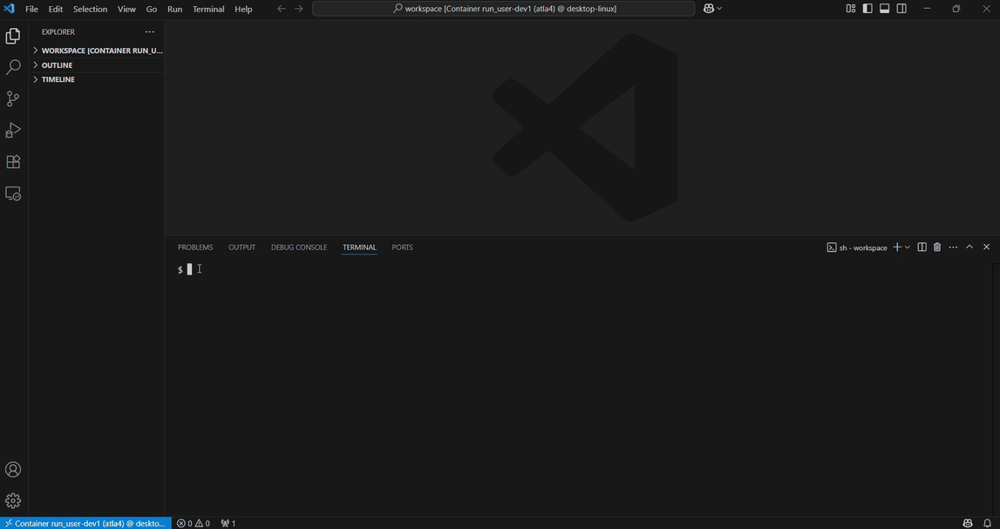
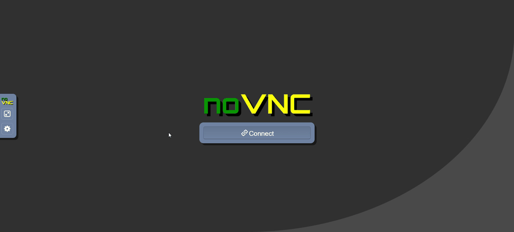

<<<<<<< HEAD
# 配布データと応募用ファイル作成方法の説明

バージョン: 1.1.0

本コンペティションで配布されるデータと応募用ファイルの作成方法や投稿する際の注意点などについて説明する.

1. [配布データ](#配布データ)
1. [応募用ファイルの作成について](#応募用ファイルの作成について)
1. [コンペティションサイトで取得できる対戦ログデータ](#コンペティションサイトで取得できる対戦ログデータ)
1. [投稿時の注意点](#投稿時の注意点)

※本ドキュメントはChromeのMarkdown Viewerを導入した状態でChromeブラウザでみることを推奨する.

## 配布データ

配布されるデータは以下の通り.

- [シミュレータ環境](#シミュレータ環境)
- [応募用サンプルファイル](#応募用サンプルファイル)

### シミュレータ環境

実行プログラム等を含む空戦を再現するシミュレータ環境. `simulator_dist.zip`が本体で, 解凍すると, 以下のようなディレクトリ構造のデータが作成される.

```bash
simulator_dist
├── Agents                            : 行動判断モジュールを格納したディレクトリ
├── common                            : コンペティションで定義されている戦闘場面などの設定ファイルを格納したディレクトリ
├── dist                              : シミュレータ本体を含めた依存ライブラリのwhlファイルを格納したディレクトリ
│   ├── linux                         : Linux(x86)用のwhlファイル
│   ├── linux_aarch64                 : Linux(arm64)用のwhlファイル(MacOS向けDockerイメージで使用)
│   └── macos                         : MacOS(Apple Silicon)用のwhlファイル
├── dockerfiles                       : Dockerによる環境構築に使われるベースイメージファイルを格納したディレクトリ
│   ├── Dockerfile.cpu                : CPU用の環境
│   ├── Dockerfile.gpu                : GPU用の環境
│   └── Dockerfile.macos              : MacOS用の環境
├── docs                              : 説明資料を格納したディレクトリ
│   ├── html
│   │   └── core
│   │       └── index.html            : 説明資料のトップページ
│   └── 参考資料_第4回空戦AIチャレンジ
│       └── acac4_tutorial.pdf        : 第4回空戦AIチャレンジのチュートリアル資料（参考）
├── figs                              : 説明図などを格納したディレクトリ
├── simulator                         : シミュレータ本体、強化学習サンプル
├── src                               : 対戦などを行うためのモジュールを実装したプログラム
├── docker-compose.yml                : 仮想環境を構築するための定義ファイル
├── license.txt                       : ライセンスファイル
├── make_agent.ipynb                  : エージェントを作成するための簡単な手順を示したノートブック
├── README.md                         : このファイル
├── replay.py                         : 戦闘シーンを動画として作成するプログラム
└── validate.py                       : エージェント同士の対戦を実行するプログラム
```

#### 説明資料

説明資料はDoxygenで生成されており, [docs/html/core/index.html](docs/html/core/index.html)にトップページがある.

ページ構成は以下の通り.

```bash
index.html
├─ 環境構築方法
├─ シミュレーションに関する説明
├─ 行動判断モデルの学習のための機能
├─ 基本的な空対空戦闘場面のシミュレーション
├─ プラグインについて
└─ 第5回空戦AIチャレンジ向けチュートリアル
```

なお, 説明資料中のファイルパスは`simulator`ディレクトリを基準とした相対パスで書かれている.

シミュレータにデフォルトで実装されている初期行動判断モデルについては[ここ](docs/html/core/page_r8_contest_initial_rulebased_agent.html)を参照. なお, 本モデルは本コンペティションにおいてベンチマークとして参戦する.

### 応募用サンプルファイル

応募用のサンプルファイル. 実体は`sample_submit.zip`で, 解凍すると以下のようなディレクトリ構造のデータが作成される.

```bash
sample_submit
├── __init__.py
├── args.json
└── config.json
```

詳細や作成方法については[応募用ファイルの作成について](#応募用ファイルの作成について)を参照すること.

## 応募用ファイルの作成について

応募用ファイルは学習済みモデルなどを含めた, 行動判断を実行するためのソースコード一式をzipファイルでまとめたものとする.

### 環境構築

まずは実行テストなどを行う準備として, 環境構築を行う. 主に手持ちのPCのローカル環境で行う方法とDockerでコンテナ型仮想環境を構築する方法がある. 評価システムで運用されている環境を再現する意味ではDockerにより構築する方が望ましい.

#### ローカル環境で構築する場合

推奨OSは`Ubuntu 22.04`. WindowsOSの場合は, `wsl`を導入したうえで, Ubuntu環境を構築しておくとよい. 導入方法については[こちら](https://learn.microsoft.com/ja-jp/windows/wsl/install)を参照されたい. また, AnacondaなどのPython環境(Pythonの推奨バージョンは3.10)を構築しておくことが必要である. 構築しておらず, Anacondaを導入する場合は[ここ](https://www.anaconda.com/download)より, 自身のOSから判断してインストーラをダウンロードしてインストールできる. そして以下のPythonライブラリがインストールされているとする(torch以外は厳密にバージョンを合わせる必要はないが, なるべく合わせておく).

```plaintext
torch==2.7.0
tensorflow==2.13.0
pandas==2.1.4
scikit-learn==1.6.1
lightgbm==4.5.0
timeout-decorator==0.5.0
opencv-python-headless==4.11.0.86
```

インストールしていない場合は`pip`などによりインストールしておくこと. 例えば, `torch`は[ここ](https://pytorch.org/get-started/previous-versions/), `tensorflow`は[ここ](https://www.tensorflow.org/install)を参照.


`./dist`以下にシミュレータ本体とその他依存パッケージのビルド済みのwhlファイルがある. 以下のコマンドを実行して, 実際にシミュレータ環境を構築されたい.

```bash
$ cd dist/linux # linux, x86の場合. Linux(arm64)の場合は dist/linux_aarch64, MacOS(Apple Silicon)の場合は dist/macos
$ pip install -r requirements.txt
...
```

ソースからビルドしたい場合(時間がかかる)は`simulator/README.md`又はドキュメントの[環境構築方法](docs/html/core/page_installation.html)のページを参照すること.

##### MacOS(Apple Silicon)での構築

制約はあるが, MacOSで環境構築することは可能. `./dist/macos`にビルド済みのwhlファイルを用意してあるので, インストールする場合は利用すること.

ソースからビルドする場合, 以下の点に注意.

- CMakeのバージョンは3.30未満のものを使用すること.

3.30以降だとFindBoost関係の互換性がなくなりビルドに失敗してしまうため, 以下を参考に, 3.29.6のcmake.rbをダウンロードし, `brew install ./cmake.rb`によりインストールする.
https://github.com/Homebrew/homebrew-core/blob/master/Formula/c/cmake.rb

- HandyRLサンプルはMPSを使用できるが, rayがMPSを認識しないので, yamlのtrain_argsのnum_gpusを0にすること.

PyTorchはMPSに対応しているためHandyRLサンプルの該当部分はCUDAとMPSで分岐するよう修正しているが, rayがMPSをGPUとして認識しないため, yamlにおけるrayのリソース指定(num_gpus)は0にする必要がある旨コメントを追記してある.


#### Dockerで構築する場合

Dockerで環境構築する場合, Docker Engineなど, Dockerを使用するために必要なものがない場合はまずはそれらを導入しておく. [Docker Desktop](https://docs.docker.com/get-docker/)を導入すると必要なものがすべてそろうので, 自身の環境に合わせてインストーラをダウンロードして導入しておくことが望ましい. 配布時の`docker-compose.yml`は, NVIDIA GPU上での実行を前提とした環境(ベースイメージの元となっているDockerfileは`dockerfiles/Dockerfile.gpu`)となっている. 詳細は[CUDA環境の利用](#cuda環境の利用)を参照.

```yml
services:
  dev1:
    build:
      context: .
      dockerfile: dockerfiles/Dockerfile.gpu
    deploy:
      resources:
        reservations:
          devices:
            - driver: nvidia
              count: 1
              capabilities: [gpu]
    container_name: atla5
    ports:
      - "8080:8080"
    volumes:
      - .:/workspace
    tty: true
```

GPU環境を持っていないならば, CPU上での実行を前提とした環境(ベースイメージの元となっているDockerfileは`dockerfiles/Dockerfile.cpu`)を構築する. 具体的には, `docker-compose.yml`を以下のように編集する. `dockerfile`の項目を`Dockerfile.cpu`に変えるだけでなく, **GPUの割り当てを要求する`deploy`の項目も併せて削除すること**(残したままだとGPUのない環境では起動に失敗する). なお, 評価システムではx86 CPU上での実行となる.

```yml
services:
  dev1:
    build:
      context: .
      dockerfile: dockerfiles/Dockerfile.cpu
    container_name: atla5
    ports:
      - "8080:8080"
    volumes:
      - .:/workspace
    tty: true
```

そして, 以下のコマンドを実行することで立ち上げる.

```bash
$ docker compose up -d
...
```

`docker-compose.yml`は編集するなりして, 自身が使いやすいように改造してもよい. 無事にコンテナが走ったら, 必要なデータなどをコンテナへコピーする.

```bash
$ docker cp /path/to/some/file/or/dir {コンテナ名}:{コンテナ側パス}
...
```

そして, 以下のコマンドでコンテナの中に入り, 分析や開発を行う.

```bash
$ docker exec -it {コンテナ名} bash
...
```

`コンテナ名`には`docker-compose.yml`の`services`->`dev1`->`container_name`に記載の値を記述する. `.`をコンテナ側の`/workspace`へバインドマウントした状態(`.`でファイルの編集などをしたらコンテナ側にも反映される. 逆もしかり.)で, `/workspace`からスタートする. さらにGUI機能も導入されているため, GUIでシミュレータを動作可能(後述).

##### MacOS(Apple Silicon)での構築

`Dockerfile.cpu`はx86を前提としているので, 代わりにarm64用の`Dockerfile.macos`を用いること(`docker-compose.yml`の`services`->`dev1`->`dockerfile`の項目を`Dockerfile.macos`と記載し, 上記のCPU用と同様に`deploy`の項目を削除する). ただし, DockerはMPSに対応していないので, MPSを用いる場合はローカルで環境構築を行うこと.

また, 以下のような制約がある.
- テスト実行において, コマンドライン上で可視化をオンにしても表示されないが, VNCを使えば可視化できる.
- MPSを認識しないのでcpu-onlyではあるが, 強化学習サンプルは動作する.
- x86イメージでも, Apple Virtualization frameworkではなくDocker VMMで起動すれば一応動作する. ただし, VNCを使っても可視化できず, rayが使えないので強化学習サンプルは動作しないため, x86環境での投稿前動作確認程度にしか使えない.

##### CUDA環境の利用

ホスト側にCUDA環境に対応したGPUがある場合, CUDA環境に対応したイメージからコンテナを構築可能. 実際にGPUがコンテナ内で有効になっているかどうかは以下のコマンドで確認できる.

```bash
# コンテナに入った後
$ python -c "import torch; print(torch.cuda.is_available())"
True
$ python -c "import tensorflow as tf; print(tf.config.list_physical_devices('GPU'))"
...{GPUデバイスのリスト}...
```

#### その他の方法で構築する場合

その他の方法としては, 例えば[Google Colab](https://colab.research.google.com/?hl=ja)がある. Googleアカウントを持っていないならば, 事前に作成しておく必要がある. そのうえで配布シミュレータ`simulator_dist.zip`を`/content`直下にアップロードして, 新規のノートブック上で解凍し, [ローカル環境で構築する場合](#ローカル環境で構築する場合)と同様の手順で環境を構築すれば分析を進めることができる. なお, OSやPythonのバージョンは推奨バージョンと必ずしも一致しないことに注意すること.

#### GUI機能について

[VSCode](https://code.visualstudio.com/)を導入済みであれば, VSCodeから(コンテナに接続などして)実際に分析や開発などを行うことが可能. [Dockerで構築する場合](#dockerで構築する場合), GUIとしては`lxde`と, VNC(Virtual Network Computing)とnoVNCを導入した状態となる. よって, HTTPサーバーで公開すれば, クライアント側はブラウザでアクセスするだけで原理的にはリモートデスクトップ環境を使えるようになる. Dockerから構築した場合は`jupyter lab`も利用可能となっている.

##### VSCodeの利用

例えばWindowsOSの場合は[Remote-WSL](https://marketplace.visualstudio.com/items?itemName=ms-vscode-remote.remote-wsl)を導入しておくと, VSCodeからlinux環境(wsl)にアクセスすることができる. 導入後, コマンドパレットで`wsl`と打つと一覧に`WSL: New Window`などとでるので, それを選択することで機能が使える. また, [VSCode](https://code.visualstudio.com/)には立ち上げたDockerコンテナに接続して開発を行える[拡張機能](https://code.visualstudio.com/docs/devcontainers/containers)がある. まずVSCode [設定]→[拡張機能]→[Dev Container]:インストールする. その後コマンドパレットで`dev..`と打つと一覧に`Dev Containers: Attach to Running Container`が出るのでそれを選択して, 立ち上げたコンテナ名を選択すると, 別ウィンドウでワークスペースが立ち上がる. Pythonやjupyterの拡張機能をインストールし, Pythonインタープリタとjupyterのカーネルはベースイメージのものを選択すると作業環境ができる. これらを導入することで, VSCodeの高度なインテリセンス機能などを活用できる.

##### VNCの利用

[Dockerで構築する場合](#dockerで構築する場合), 以下の操作によりVNCサーバーを立ち上げてGUI操作ができるようになる.

```bash
$ USER={ユーザー名} vncserver :1 -geometry 1500x900 -depth 24
...
```

一旦立ち上がったがすぐkillされた場合は以下のコマンドで再度サーバーを立ち上げてみる.

```bash
$ tigervncserver -xstartup /usr/bin/startlxde -geometry 1500x900 -depth 24
...
```

ログインユーザーとして, ディスプレイ:1に解像度1500x900, 24bit colorのVNCデスクトップを立ち上げている. 解像度と色は好みで設定する. パスワード入力が求められるので, 6-8文字の簡単なパスワードを設定する.

起動しているかどうかは以下のコマンドで確認できる.

```bash
$ vncserver -list
...
```

削除するときは`vncserver -kill :1`を実行すればよい. ログは`/root/.vnc/*.log`に出力されているので, `tail -F /root/.vnc/*.log`で監視できる.

次にnoVNCを設定したポートに公開する.

```bash
websockify -D --web=/usr/share/novnc/ {ポート番号} localhost:5901
```

`ポート番号`にはVNCサーバー側のポート番号(Dockerで構築した場合は`docker-compose.yml`で定義したコンテナ側のポート番号(`ports`の`:`の右側の値))を指定する. VNCでは"5900+ディスプレイ番号"のポートにサーバーが立つので, ここでは`localhost:5901`を指定している.

以上の設定のあと, ホスト側でブラウザを立ち上げて`localhost:{ホスト側のポート番号}/vnc.html`にアクセスすると, noVNCの画面が立ち上がってGUIデスクトップが表示される. 画面左のメニューで各種設定や, クリップボードの確認・編集も可能.

##### jupyter labの利用

コンテナには`jupyter lab`がインストールされている. 以下のコマンドで`jupyter lab`を立ち上げることができる.

```bash
# コンテナに入った後
$ jupyter lab --port={ポート番号} --ip=0.0.0.0 --allow-root
...
copy and paste one of these URLs:
        ...
     or ...

```

`ポート番号`には`docker-compose.yml`で定義したコンテナ側のポート番号(`ports`の`:`の右側の値)を指定する. 表示されるURLをブラウザに張り付ければjupyterの環境で作業が可能となる. Desktopから直接入ってもよい(最初にtokenを聞かれるので, URLの`token=`に続く文字列を入力する).

#### 動作確認プログラムの実行

以下のコマンドにより実際に動画付きでシミュレータが動くかどうかを確認する. 成功すると動画が再生されて勝敗結果等が出力される.

```bash
$ cd /path/to/workspace
$ python validate.py --visualize 1
...
```

なお, 動作確認をそのまま実行できるようにするため, 自分側の既定の対戦相手となる`Agents/MyAgent`には初期行動判断モデル(`Agents/BenchMark`)と同じものを配置してある. したがって, 引数を指定せずに実行した場合は初期行動判断モデル同士の対戦となる. 自分で実装したエージェントを試す際は, `Agents/MyAgent`の中身を差し替えるか, `--myagent-module-path`で自分のモジュールのパスを指定すること.

VSCodeからコンテナに接続した際にターミナルを開いて実行したときは以下のように動画付きで結果が出力される.



以下はnovncによりリモートデスクトップで実行したときの実行画面.



動画が表示されない場合, `--visualize`を0, `--replay`を1として実行して, `replay.py`によりmp4形式の対戦動画を作成して(存在する`.dat`ファイル全てに対して作成される)動画を再生する.

```bash
$ python validate.py --visualize 0 --replay 1
...
$ xvfb-run python replay.py
...
```

### 行動判断を行うプログラムの実装方法

提出すべき行動判断を実行するためのソースコード一式は以下のようなディレクトリ構造となっていることを想定している.

```bash
.
├── __init__.py              必須: 実行時に最初に呼ばれるinitファイル
├── args.json                必須: アルゴリズムに渡す引数に関する情報をまとめたjson形式のファイル
└── ...                      任意: 追加で必要なファイルやディレクトリ
```

- エージェントに対する設定に関しては例えば"config.json"などの名前でファイルとして保存しておいて, 実行時に読み込んで使用する想定である.
- `__init__.py`で定義されたメソッドに渡す情報は`args.json`を想定している.
  - 名前は必ず`args.json`とすること.
- 学習済みモデルなど, 実行に必要なその他ファイルも全て含まれている想定(必要に応じてディレクトリを作成してもよい).
- C++版の独自クラスを作成する場合は, 評価環境がx86のUbuntuなので, そこで動作するようにビルドすること.

#### `__init__.py`の実装方法

以下のメソッドを実装すること.

##### getUserAgentClass

Agentクラスオブジェクトを返すメソッド. 以下の条件を満たす.

- 引数argsを指定する.
  - `args.json`の内容が渡される想定である.
- Agentクラスオブジェクトを返す.
  - Agentクラスオブジェクトは自作してもよいし, もともと実装されているものを直接importして用いてもよい. 実装例については`make_agent.ipynb`や`simulator/sample/modules/r8_contest_sample/r8_contest_sample`以下のファイルを参照すること. r8_contest_sampleに関する解説は[第5回空戦AIチャレンジ向け強化学習Agentサンプル](docs/html/core/page_r8_contest_agent_sample.html)に記載がある.

##### getUserAgentModelConfig

Agentモデル登録用にmodelConfigを表すjsonを返すメソッド. 以下の条件を満たす.

- 引数argsを指定する.
  - `args.json`の内容が渡される想定である.
- `modelConfig`を返す. なお, `modelConfig`とは, Agentクラスのコンストラクタに与えられる二つのjson(dict)のうちの一つであり、設定ファイルにおいて

    ```json
    {
        "Factory":{
            "Agent":{
                "modelName":{
                    "class":"className",
                    "config":{...}
                }
            }
        }
    }
    ```

    の`config`の部分に記載される`{...}`の`dict`が該当する.

##### isUserAgentSingleAsset

Agentの種類(一つのAgentインスタンスで1機を操作するのか, 陣営全体を操作するのか)を返すメソッド. 以下の条件をみたす.

- 引数argsを指定する.
  - `args.json`の内容が渡される想定である.
- 1機だけならば`True`, 陣営全体ならば`False`を返す想定である.

##### getUserPolicy

`StandalonePolicy`を返すメソッド. 以下の条件を満たす.

- 引数argsを指定する.
  - `args.json`の内容が渡される想定である.
- `StandalonePolicy`を返す.

なお, 配布している`Agents/BenchMark`や応募用サンプルファイルの`__init__.py`には, 上記4つのメソッドに加えて`getBlueInitialState`というメソッドが定義されているが, 本コンペティションでは初期配置が常にランダムに決定されるため, このメソッドは呼び出されない(過去回の名残であり, 残しておいても削除しても動作に影響はない).

以下は`__init__.py`の実装例.

```Python
import os,json
import ASRCAISim1
from ASRCAISim1.policy import StandalonePolicy

#①Agentクラスオブジェクトを返す関数を定義
def getUserAgentClass(args={}):
    from BasicAirToAirCombatModels01 import BasicAACRuleBasedAgent01
    return BasicAACRuleBasedAgent01

#②Agentモデル登録用にmodelConfigを表すjsonを返す関数を定義
def getUserAgentModelConfig(args={}):
    configs=json.load(open(os.path.join(os.path.dirname(__file__),"config.json"),"r"))
    modelType="Fixed"
    if(args is not None):
        modelType=args.get("type",modelType)
    return configs.get(modelType,"Fixed")

#③Agentの種類(一つのAgentインスタンスで1機を操作するのか、陣営全体を操作するのか)を返す関数を定義
def isUserAgentSingleAsset(args={}):
    #1機だけならばTrue,陣営全体ならばFalseを返すこと。
    return True

#④StandalonePolicyを返す関数を定義
class DummyPolicy(StandalonePolicy):
    def step(self,observation,reward,done,info,agentFullName,observation_space,action_space):
        return None #action_space.sample()

def getUserPolicy(args={}):
    return DummyPolicy()

```

応募用サンプルファイル`sample_submit.zip`も参照すること. また, `simulator/sample/scripts/R8Contest/MinimumEvaluation`以下にある`HandyRLSample01S`や`HandyRLSample01M`などのサンプルモジュールも参考にされたい. なお, `HandyRL`についてはサンプルで使用しているNNクラスに対応した`StandalonePolicy`の派生クラスが提供されている(`simulator/core_plugins/HandyRLUtility/HandyRLUtility`以下を参照.).

#### 強化学習サンプル

このシミュレータにはHandyRLを用いた強化学習サンプルが同梱されている. 動かしたい場合は[ここ](docs/html/core/page_r8_contest_handyrl_sample.html)を参照すること.

### 実行テスト

モデル学習などを行い, 行動判断を行うプログラムが実装できたら, 初期行動判断モデル(`./Agents/BenchMark`以下に実装されている)との対戦を実行する.

```bash
$ python validate.py  --myagent-id agent_id --myagent-module-path Agents/MyAgent --result-dir ./results
...
```

- `--myagent-id`には好きな自分のエージェント名を指定する. デフォルトは`0`.
- `--myagent-module-path`には実装したプログラム(`__init__.py`など)が存在するパス名を指定する. デフォルトは`Agents/MyAgent`. **実行時のカレントディレクトリからの相対パスで指定すること**(内部でパス区切り文字を`.`に置き換えてモジュールとして読み込むため, `/path/to/MyAgent`のような絶対パスを指定すると読み込みに失敗する).
- `--result-dir`には対戦結果ログを格納するディレクトリを指定する. デフォルトは`./results`
- `--youth`はユース部門の設定で実行する場合は`1`, オープン部門の場合は`0`とする. デフォルトは`0`. **参加予定の部門の設定になっていることを確認すること**

実行に成功すると対戦が行われ, `{result_dir}/{agent_id}`以下に対戦結果ログ等が格納される.

- `{result_dir}/{agent_id}/validation_results.json`(いずれも既定値の場合は`./results/0/validation_results.json`)が対戦結果ログとして保存される. 対戦時の終了までにかかった時間や勝利数やスコアなどの情報が含まれる.
- `--replay`を`1`にすると対戦動画情報(`.dat`ファイル)が保存される. デフォルトは`0`.
  - さらに`--visualize`を`1`にすると実行中に動画が再生されるが, 実行に時間がかかる. デフォルトは`0`.
- `--num-validation`に指定した値の回数だけ対戦が行われる. デフォルトは`3`.
- `--time-out`に指定した値(単位は[秒])までに行動を返さなかった場合は行動空間からランダムサンプリングされる. デフォルトは`3.0`.
- `--memory-limit`に指定した値(単位は[GB])で対戦実行時の使用メモリの上限を設定する. 超えた場合はエラーとなり, 対戦は無効となる. デフォルトは`7.5`.
- `--random-test`を`1`にするとシミュレーションを行わずランダムに勝敗を付ける. デフォルトは`0`であるが, デバッグをしたいときなどに`1`にする.
- `--control-init`は過去回で初期配置の指定方法を切り替えるために使用していたオプションだが, 本コンペティションでは初期配置は常にランダムであり, 指定した値は動作に影響しない(後方互換のために残されている). デフォルトは`random`.
- `--make-log`を`1`にすると対戦実行時に各ステップで返される自分の陣営における`observations`, `infos`とエージェントが返す`actions`のログを記録する. デフォルトは`1`でこちらがコンペティションにおける設定.
  - `{result_dir}/{agent_id}`以下に`log_{fight_n}.json`として保存される.
- `--max-size`に指定した値(単位は[GB])で対戦実行時のログデータがメモリを占有する大きさの上限を決める. 上限を超えると`observations`, `infos`, `actions`のログは記録として残らない. デフォルトは`0.08`.
  - 実行後標準出力で`Log size for fight {n}: ...[GB]`などと表示されるので, サイズを確認できる.
  - 上限を超えた場合は`log_{fight_n}.json`は保存されない.
- `--color`に"Red"または"Blue"を指定することで自分の陣営の色を指定する. "Red"を指定した場合は西軍, "Blue"を指定した場合は東軍となる. デフォルトは"Red".

`validation_results.json`のフォーマットは以下の通り.

```json
{
 "own": "Red",
 "details": {
  "0": {
   "finishedTime": 49.28814506530762,
   "step_count": 322,
   "numAlives": {
    "Blue": 5.0,
    "Red": 4.0
   },
   "endReason": "ELIMINATION",
   "scores": {
    "Blue": 0.76,
    "Red": 0.24
   },
   "error": false,
   "red_error_message": "",
   "blue_error_message": "",
   "config": {
    ...
   }
  },
  ...
 },
 "win": 1,
 "loss": 2,
 "draw": 0,
 "status": "success",
 "message": "ok"
}
```

`own`は自分の陣営の色, `details`には各戦闘ごとの結果が0から始まる連番のキーで格納される. 各戦闘には`finishedTime`(対戦プログラムの実行にかかった時間. 単位は秒), `step_count`(対戦が終わるまでにかかったステップ数), `numAlives`(生き残った戦闘機と護衛対象機の数), `endReason`(終了理由), `scores`(各陣営のスコア), `error`(プログラム的なエラーを起こしたか否か), `red_error_message`(赤側が起こしたエラーの内容. ない場合は空.), `blue_error_message`(青側が起こしたエラーの内容. ない場合は空.), `config`(戦闘場面に関する初期条件など)が含まれる. `win`は勝利回数, `loss`は敗北の回数, `draw`は引き分けの回数(合計が`--num-validation`に指定した対戦回数となる), `status`はプログラム実行のステータスで,"success"の場合は成功, "error"の場合は失敗, `message`にはプログラムが正常に終了した場合は"ok", それ以外の場合はエラーの内容が記載される. `config`において`AssetConfigDispatcher`->`{Blue,Red}InitialState`->`elements`の`value`->`instanceConfig`で初期配置に関する情報を確認できる.

なお, 決着した対戦(護衛対象機の撃破(撃墜又は相手の自滅), 又は一方の失格による決着)における勝者の対戦スコアは`0.6 + 0.3 * (命中弾数 / 射撃弾数) + 0.1 * min(1, max(0, 2 - 経過秒数 / 900))`で算出され, 敗者には`1.0 - (勝者のスコア)`が加算される. 命中弾数は勝者の誘導弾が命中した数, 射撃弾数は勝者が発射した誘導弾の数(撃墜された機体の分も含む)で, 射撃弾数が0の場合は命中率の項を0とする. 第3項は決着までの速さに応じたボーナスで, 経過時間が900秒以内なら0.1, 900〜1800秒では線形に減少し, 1800秒以上では0となる. 時間切れ, 双方失格, 又は護衛対象機の同時撃破による引き分けの場合は双方に0.5が加算され, エラーによる無効試合の場合は双方0となる.

`log_{n}.json`のフォーマットは以下の通り.

```json
{
 "observations":
 [
  {
    "ptime":0.1,
    "data":
    {
      "1":...,
      "2":...
    }
  },
  ...
 ],
 "actions":
 [
  {
    "ptime":0.1,
    "data":
    {
      "1":...,
      "2":...
    }
  },
  ...
 ],
 "infos":
 [
  {
    "ptime":0.1,
    "data":
    {
      "1":...,
      "2":...
    }
  },
  ...
 ]
}
```

`observations`は前処理後の観測値, `actions`は取った行動, `infos`はスコアなどの情報が各ステップごとに格納されている. `ptime`がシミュレーション内の時刻で`data`が実際のデータ. なお, `ptime`の間隔は`modelConfig`で設定した設定値によって変わる.

なお, BenchMark以外と対戦したい場合は別のエージェントを作成してそのモジュールディレクトリを`--opponent-module-path`に指定して実行すればよい. また,`--opponent-id`には対戦相手の名前を指定できる.デフォルトは`1`.

#### replay.pyについて

`validate.py`で`--myagent-id`を指定していた場合には`replay.py`にも同じ名前で`--myagent-id`を指定すること. 同様に, `validate.py`で`--result-dir`を指定していた場合には, `replay.py`の`--movie-dir`に同じパスを指定すること(いずれもデフォルトは`./results`). また,`y`又は`--youth`を指定するとユース部門, 指定しなければオープン部門として描画される.


### 応募用ファイルの作成

上記の[ディレクトリ構造](#行動判断を行うプログラムの実装方法)となっていることを確認して, zipファイルとして圧縮する.

```bash
$ cd /path/to/Agents
$ zip -r submit ./MyAgent
...
```

実行後, 作業ディレクトリにおいて`submit.zip`が作成される.

## コンペティションサイトで取得できる対戦ログデータ

コンペティションサイトに投稿したアルゴリズムの対戦ログデータをサイトで取得することができる. 内容は`validate.py`を実行したときに得られるログデータとほぼ同じ. 1対戦のログデータ(`detail`->`logs`)のメモリを占有する大きさの上限は0.08[GB]で, 超えた場合は対戦実行時に各ステップで返される自分の陣営における`observations`, `infos`とエージェントが返す`actions`のログは残らない(対戦自体は有効)が, 勝敗結果や最終スコアなどの集約した情報は残る. フォーマットは以下の通り.

```json
[
  {
    "score": 1248.614892485913,
    "record": {
      "win": 0,
      "loss": 3,
      "draw": 1,
      "nocontest": 0
    }
  },
  {
    "own": "Red",
    "result": "Lose",
    "detail": {
      "finishedTime": 9.92264437675476,
      "step_count": 899,
      "numAlives": {
        "Blue": 2.0,
        "Red": 1.0
      },
      "endReason": "TIMEUP",
      "error": false,
      "logs": {
        "observations": [...],
        "actions": [...],
        "infos": [...]
      },
      "scores": {
        "Blue": 0.5748469871489575,
        "Red": 0.0
      }
    }
  },
  ...
]
```

"score"で現在のレーティング, "record"でこれまでの戦績を確認できる("win"が勝利数, "loss"が敗北数, "draw"が引き分け数, "nocontest"が無効試合数). コンペティションサイトの投稿画面において取得可能である. ただし, 対戦バッチが実行されるたびに内容が上書きされるため, 注意が必要である. なお, 投稿後検証処理時に初期行動判断モデルとの対戦が行われるが, そちらの対戦ログ(`logs`の内容)は含まれないので, 情報が欲しい場合はローカル環境で実行して確認すること.

## 投稿時の注意点

投稿する前に自身のローカル環境で実行テストを行い, エラーなく実行できるか確認すること. 投稿時にエラーが出た場合, 以下のことについて確認してみる.

- 提出するプログラム内でインターネット接続を行うような処理を含めていないか. 評価システム上でインターネット接続はできない.
- 実行時間がかかりすぎていないか. 時間がかかりすぎるとランタイムエラーとなることがある. 使用メモリなども見直すこと.
- コンペティションサイトで対戦ログデータをダウンロードして確認したい場合, 上限があるので, ローカル環境でテストして上限を超えないか確認しておくこと.

## 更新情報

本ドキュメントおよび配布データの更新履歴を以下に記載する.

- v1.0.0: 初版.
- v1.0.1: Red護衛機の軌道の不具合を修正し, Linux/macOS向け`r8_contest_models-1.0.0-py3-none-any.whl`を更新. ソースからビルドする際に不足していたファイルを追加.
- v1.0.2: 以下の変更を実施.
  - 評価環境そのもの(シミュレータ本体および評価用実行コード)の挙動は変更していないため, 環境を再構築する必要はない. `simulator/sample/`のサンプルC++・強化学習サンプル・設定を評価環境の仕様に合わせて更新し, `simulator/doc/`の説明資料も修正.
  - 護衛対象機の周回方向を両陣営独立にランダム化. 併せて周回速度のランダム化範囲を狭め(225〜275[m/s]), 説明資料の記述と`simulator/sample/scripts/R8Contest/HandyRLSample`のyamlを更新.
  - 強化学習サンプルにおいても評価環境と同条件で護衛対象機がランダム化されるよう, `HandyRLSample/handyrl/envs/ASRC/ASRCAISim1.py`に専用の`factoryConfigReplacer`を追加.
  - 強化学習Agentサンプル`R8ContestAgentSample01`の味方機observation生成において, オフセットが加算されず値が上書きされる不具合を修正.
  - 強化学習Agentサンプル`R8ContestAgentSample01`の観測空間定義に, IRSTによる彼機2次元航跡`enemy_2d`とそのobservation maskが欠落していた不具合を修正.
  - `dist/*/requirements.txt`に`ray`のバージョン指定(2.46.0)を追加.
  - `src/fight.py`の対戦スコア計算に関する説明コメントが旧仕様のままであったため, 実装どおりの内容(決着した場合は勝者に`0.6 + 0.3 * hit_rate + time_bonus`, 敗者に`1.0 - (勝者の得点)`を加算. 引き分けは双方0.5, エラーによる無効試合は双方0.)に修正. コメントのみの修正であり, 対戦の挙動やスコアの算出結果に変更はない.
- v1.0.3: 強化学習モデルサンプルにおいて、設定済みの`entity_equivariant`が観測キーの有無により適用されない不具合を修正.
- v1.1.0: シミュレータ本体, 評価用実行コード, 対戦設定の不具合修正および仕様変更.
  - **環境の再構築が必要.** `dist/*`以下のwhlファイルをすべて更新した(バージョン番号は据え置き)ため, `pip install --force-reinstall -r requirements.txt`等で再インストールすること. ヘッダファイルも変更しているため, ソースからビルドしている場合やC++プラグインを独自に作成している場合は再ビルドが必要.
  - シミュレータ本体(`ASRCAISim1`)の不具合修正.
    - 誘導弾の命中判定(`EkkerMissile`): 1ステップ内の最接近時刻の計算式の係数が誤っており(`-2A・B/|B|²`), 実質的にステップ境界での距離のみで判定されていた. 交差角の大きい会敵で, 本来命中する誘導弾が外れと判定されることがあった.
    - 誘導弾の抗力係数(`EkkerMDT`, `EkkerMDTV2`): 近似式がMach 5.58を超える領域で不正な値となっていた.
    - IRSTの航跡のUUID: 毎ステップ変わり, 同一目標の航跡を対応付けできなかった. 新たな目標を探知した時点でUUIDを割り当て, 探知が途切れるまで同じ値を使い続けるようにした(味方機の航跡とは引き続き照合できない).
    - 味方機間の航跡のマージ(`SensorDataSanitizer`, `Track3D/Track2D::merge`):
      - 照合した航跡の番号が常に先頭となり, 航跡の出所リスト(`trackSource`)への追記先が誤っていた.
      - マージ対象を値コピーしていたため, 同一目標の航跡が算術平均で合成されず破棄されていた.
      - 算術平均に自身の航跡の値が含まれていなかった(上記の修正により顕在化するもの).
    - 撃墜された機体の運動情報(`OtherDataSanitizer`): 撃墜時点の`motion`が味方機に共有され続けていた.
    - レーダの観測速度: 観測する側の機体が回転していると, 実際の速度から大きくずれる(上下の向きが逆になることもある)ことがあった. 航跡の速度を機体座標系の速度として扱っていたため, 座標変換時に, 観測側の回転と誤差を含む観測位置から計算される余分な速度が加わっていた. 下記の`FREE_VECTOR`の導入により修正し, 併せてIRST・MWSの航跡の方向変化率も観測側の運動の影響を受けない値とした.
    - 座標値の種類に自由ベクトル(`CoordinateType::FREE_VECTOR`)を新設し, `MotionState`に変換関数(`vecBtoP`等)を追加. 航跡の速度(`Track3D::vel`)と角速度(`Track2D::omega`)の種類を`VELOCITY`/`ANGULAR_VELOCITY`から`FREE_VECTOR`に変更した.
  - `r8_contest_models`の不具合修正.
    - `PlanarFighter`(ユース部門の戦闘機・護衛対象機)の飛行制御モード`"direct"`:
      - 旋回コマンド(yaw)が常に0となり, 反映されていなかった.
      - yawの上下限の計算でピッチ角速度の上下限を符号付きのまま合成していたため, 左右で旋回率の上限が非対称となっていた. ピッチ・ヨー角速度の上下限4つの絶対値の最大値を, 左右共通の上限とした.
    - `R8ContestMassPointFighter`(オープン部門)の飛行制御モード`"direct"`: 加速度コマンド(`accel`)の上下限を, 誤ってロールレートの範囲から取得していた.
    - 護衛対象機の初期ヘディング(`R8ContestTwoTeamCombatMatchMaker`): 周回コースの円弧区間に配置された場合, 進行方向から90°ずれていた.
    - MatchMaker: 非対称設定時の機体性能の生成がエラーになっていた.
  - 護衛対象機のランダム化方法の変更.
    - 周回速度(目標速度)と周回方向: オープン部門は陣営ごとに独立に, 速度を225〜275[m/s], 方向を左右それぞれ確率0.5で決める. ユース部門は250[m/s], 右回り(`"right"`)で固定. MatchMakerの`asset_spec_randomization`の`escorted_agent`で設定し, 決めた値を初期速度・初期ヘディングにも反映する.
    - これに伴い, `common/*_asset_placeholder.json`に護衛対象機用Agentのプレースホルダ(`BlueEscorted1`/`RedEscorted1`)を追加し, `common/*_mission_config.json`の護衛対象機のAgentをプレースホルダ経由の指定に変更した.
    - RCS・IR放射強度のスケール: 評価用実行コードに説明資料と異なるランダム化範囲(基準値に対してRCSは6.4〜16.0倍, IR放射強度は2.56〜4.0倍)が設定されていた(ただし護衛対象機には反映されておらず, 実際には基準値で固定されていた). 説明資料の記載に合わせ, ランダム化は行わず基準値で固定とした. 併せて最大速度のランダム化も廃止した.
  - 評価用実行コード(`src/fight.py`, `src/validator.py`)の変更.
    - 命中弾数を「相手の初期機数 - 生存機数」による近似から, 命中イベントによる直接の計数に変更. 射撃弾数も撃墜された機体の分を含めて数えるようにした. 勝者の対戦スコアは`0.6 + 0.3 * (命中弾数 / 射撃弾数) + 0.1 * min(1, max(0, 2 - 経過秒数 / 900))`, 敗者は`1.0 - (勝者のスコア)`.
    - 対戦結果の`details`から`hit_rate`と`time_bonus`を削除.
    - タイムアウト時の代替行動に相手陣営の分まで含まれ, 相手の行動がランダムな値で上書きされることがあった不具合を修正.
    - `src/validator.py`で, 引き分けの対戦が勝ち・負け・引き分けのいずれにも数えられなかった(`validate.py`の結果の`draw`が0のままになっていた)不具合を修正. 併せて`src/fight.py`の`random_test`時の引き分けの表記も`'Draw'`に統一.
  - 強化学習サンプル等の変更.
    - `simulator/sample/scripts/R8Contest/HandyRLSample`のyamlと`configs`を上記の護衛対象機のランダム化方法に合わせ, 評価環境と同じ対戦条件にした. これに伴い, v1.0.2で`handyrl/envs/ASRC/ASRCAISim1.py`に追加した専用の`factoryConfigReplacer`は削除した.
    - `simulator/sample/scripts/R8Contest/MinimumEvaluation`の`evaluator.py`と設定ファイルも評価環境と同じ内容に更新した.
  - 説明資料(`simulator/doc/`, `docs/html`)の更新.
    - 座標値の種類`FREE_VECTOR`と自由ベクトルの変換関数の説明を追加.
    - Agentのobservablesの説明に, `irRadiationIntensityScale`, IRSTの性能(`Lref`, `thetaFOR`), 記載が漏れていたIRSTの航跡(`irst.track`. `Track2D`のリスト)を追加.
    - シナリオの説明:
      - 護衛対象機のランダム化の記述を更新.
      - レーダの探知の記述を部門別に分けた(オープン部門はセンサ誤差・確率的探知あり, ユース部門は真値を遅れや欠損なく観測できる).
      - 戦域を逸脱した場合のペナルティ(1秒ごとに逸脱距離1kmあたり0.01点を機体ごとに積算し, 合計10点で失格)を, 実装どおりの内容に修正.
=======
# -AI-
空戦ＡＩコンテスト1モデルデータ置き場<br>
→モデルデータは/simulator_dist/prototype/~に置いておく<br>
→__init__.py, agent.py, config.json, args.jsonが中心<br>
→agent.py/makeobsで参照するデータは/simulator_dist/docs/html/core/page_r8_contest_agent_observables_and_commands.htmlに早見表アリ<br>
→--replay 1で.datの戦闘記録を出力する場合、なんかsimulator_dist/result/0/に置いたまんまだと今までの奴全部作り直しになってクソほど時間かかるので、必ずsimulator_dist/wanna_mp4/0に移動してからmp4を生成する。<br>
→wsl<br>
cd ~/simulator_dist<br>
docker compose up -d,<br>
docker exec -it atla5 bash<br>
のコンボで環境起動<br>
python validate.py --num-validation N --youth 1 --replay 0 or 1 --myagent-module-path 'Agents/prototype/エージェント名' の呪文で戦闘実行<br>
xvfb-run python replay.py --result-dir './wanna_mp4'の呪文で/wanna_mp4のdatファイルをmp4へ変換<br>
→細かいことは/simulator_dist/tutorial/tutorial.ipynbを参照<br>
>>>>>>> ddb8c278266c688360d17c6e15886e1c7184215f
